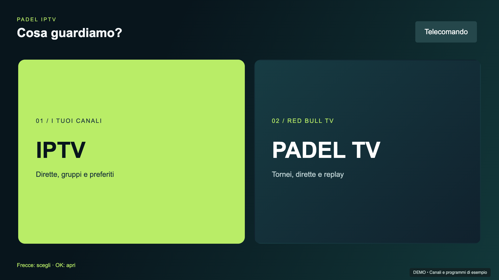
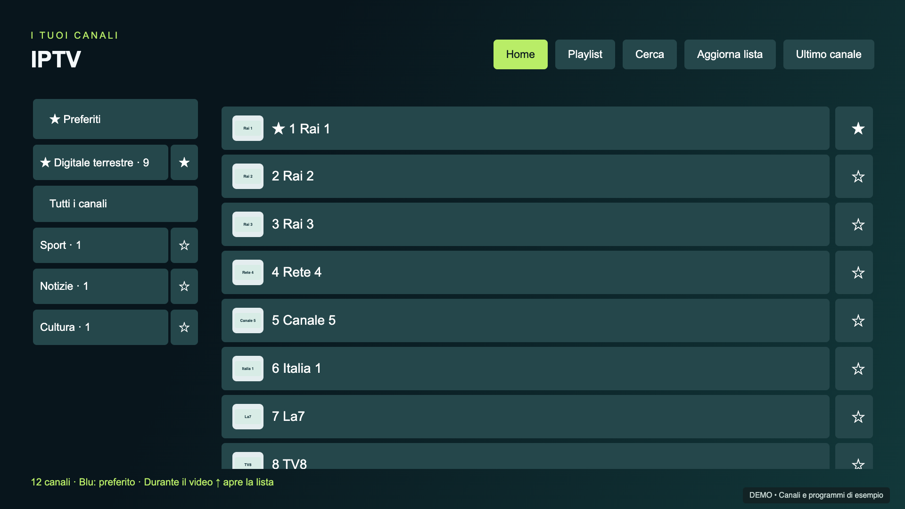
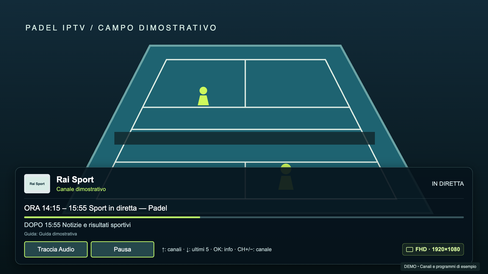
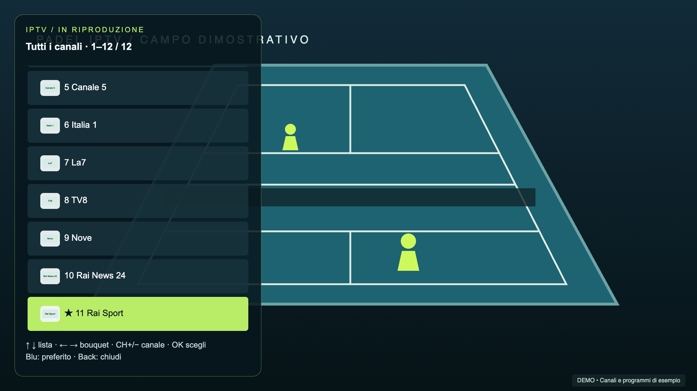
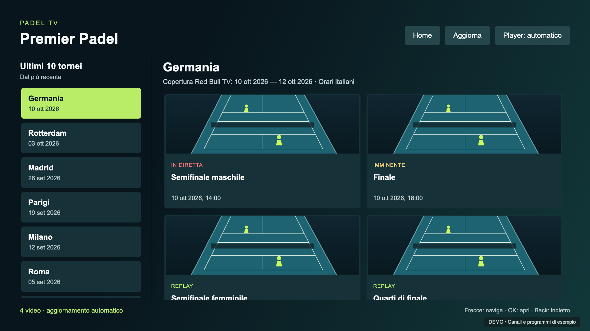
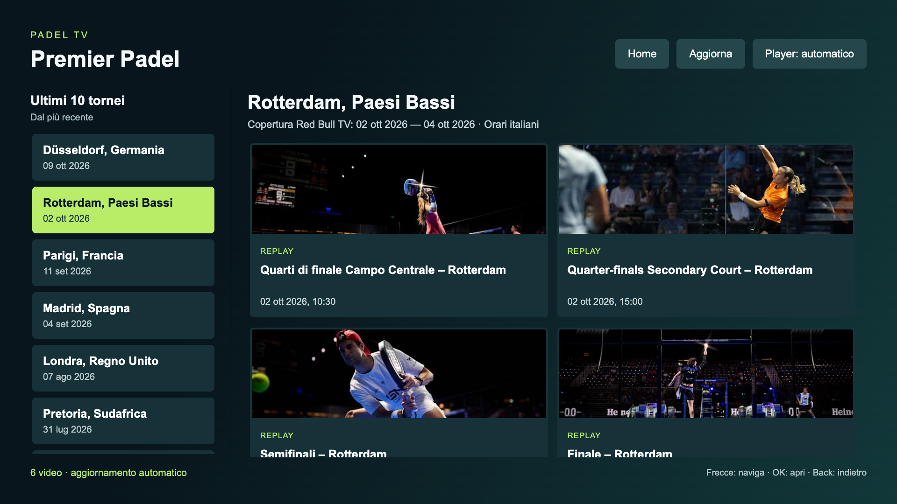
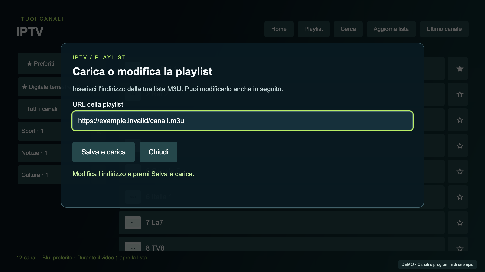

<h1 align="center">Padel IPTV</h1>

I tuoi canali. Il tuo padel. Sulla stessa TV.

<a href="https://spacecdr.github.io/PadelIPTV/">Presentazione</a> · <a href="https://github.com/spacecdr/PadelIPTV/releases/latest">Download webOS / Tizen</a> · <a href="DEVELOPMENT.md">Sviluppo</a>

App indipendente per **LG webOS e Samsung Tizen**: player IPTV per le proprie playlist M3U e catalogo dedicato al padel su Red Bull TV, con telecomando web ospitato direttamente sul televisore. Versione **0.6.3**: `.ipk` per LG e `.wgt` precompilato da firmare per Samsung, installabili in modalità sviluppatore.

**Samsung:** verificata su UE55NU7400/Tizen 4.0. Il WGT include il modulo ARM del telecomando e la correzione dei preferiti bouquet; richiede firma con certificati propri e DUID della TV. Non è un pacchetto universale per tutte le Samsung.

## Cosa puoi fare

- **Playlist dalla TV:** carica o modifica l’URL M3U da **IPTV → Playlist**, con tastiera a schermo. Il browser è facoltativo; una lista non valida conserva quella precedente.
- **IPTV:** gruppi/bouquet, ricerca, canali preferiti, bouquet preferiti in cima alla lista e ultimo canale.
- **Durante la visione:** zapping con CH+/CH− (Samsung e telecomando web; su LG frecce solo con info nascoste); freccia su apre una lista trasparente sopra il video, senza interromperlo.
- **Controlli e cronologia:** OK apre le informazioni con **Traccia Audio** e **Pausa/Riprendi**; Giù mostra gli ultimi cinque canali senza duplicati; Sinistra/Destra nella lista sovrapposta cambiano bouquet nell’ordine del catalogo. Badge della risoluzione effettiva (HD/FHD/UHD o dimensioni non standard).
- **Loghi e guida TV:** logo del canale, programma attuale e successivo, orari e avanzamento in un pannello leggibile che scompare automaticamente.
- **Padel:** ultimi 10 tornei disponibili, ordinati dal più recente; video on demand, dirette e sessioni imminenti del torneo selezionato.
- **Audio:** scelta della lingua tra le tracce rese disponibili dallo stream; preferenza salvata.
- **Telecomando web:** smartphone o computer sulla stessa rete; frecce, Invio e Indietro da tastiera, ripetizione dei cursori nelle liste, caricamento e aggiornamento della playlist.
- **Abbinamento persistente:** codice iniziale, dispositivi ricordati e revoca dalla TV. Dopo l'installazione non serve lasciare acceso un computer.

## Schermate

L’interfaccia è condivisa tra le due versioni; queste immagini illustrano la UI, non costituiscono un collaudo su ogni modello. Le schermate **Padel TV** mostrano il catalogo reale Red Bull TV nell’app, acquisito il 10 ottobre 2026, con titoli, miniature e stati disponibili in quel momento. Le schermate **IPTV** usano canali e programmi dimostrativi; il campo nel player IPTV è un’illustrazione. Nessuna playlist personale è inclusa.

| Canali e bouquet | Guida durante la visione |
|---|---|
|  |  |
| Lista sovrapposta al video | Tornei e replay |
|  |  |

[Telecomando web su smartphone](docs/assets/remote.png)

## Installazione

La [guida completa all’installazione](INSTALLAZIONE.md) descrive requisiti, account, Developer Mode, collegamento, comandi, aggiornamenti e problemi comuni per entrambi i sistemi.

| TV | File nella release | Preparazione |
|---|---|---|
| LG webOS — verificata UM7390PLC, webOS 4.10.2-29 | `it.pepis.padel.tv_0.6.3_all.ipk` | Account LG Developer, app Developer Mode, CLI webOS; app e servizio già inclusi |
| Samsung Tizen — verificata UE55NU7400, Tizen 4.0 | `PadelIPTV-0.6.3-tizen-arm-unsigned.wgt` | Account Samsung, Tizen Studio con estensioni TV/certificati, firma con il proprio DUID |

[Scarica la release](https://github.com/spacecdr/PadelIPTV/releases/latest). Il WGT è già compilato ma **non firmato**: contiene anche il server nativo ARM, senza certificati personali. Non occorre compilare C++ o installare una VM per usarlo. Il supporto NaCl necessario su Samsung limita la compatibilità; TV recenti non collaudate.

Gli ID `it.pepis.padel.tv` (LG) e `PadelIPTV1.PadelIPTV` (Samsung) restano stabili per gli aggiornamenti. Il nome visualizzato è **Padel IPTV**.

## Primo avvio e playlist

Puoi caricare e modificare l’indirizzo direttamente da **IPTV → Playlist → Salva e carica**. Il pannello ripropone l’URL attuale, accetta link HTTP/HTTPS anche senza estensione e mostra esito/errori. Alla prima apertura senza canali compare anche **Carica playlist sulla TV**.

In alternativa, apri **Telecomando e playlist** nella Home. Dal browser del telefono o computer visita l'indirizzo mostrato dalla TV (porta HTTP **8768**) e inserisci il codice di abbinamento. Nella sezione Playlist IPTV incolla l'URL HTTP/HTTPS della tua M3U: può essere anche un link senza estensione `.m3u`. Una lista vuota o non valida non sostituisce una lista già funzionante.

La release parte senza playlist. [examples/digitale-terrestre.m3u](examples/digitale-terrestre.m3u) illustra il formato con URL `example.invalid` volutamente non riproducibili: sostituiscili con sorgenti che sei autorizzato a usare. I nomi di esempio non indicano canali forniti dal progetto.

## Comandi

| Contesto | Tasto | Azione |
|---|---|---|
| Menu e cataloghi | Frecce / OK | Naviga / seleziona |
| IPTV Samsung / telecomando web | CH− / CH+ | Canale precedente / successivo nella lista di avvio |
| IPTV LG, info nascoste | Sinistra / destra | Canale precedente / successivo |
| Lista canali sovrapposta | Sinistra / destra | Bouquet precedente / successivo, secondo l’ordine del catalogo |
| IPTV in riproduzione | Su | Mostra la lista trasparente |
| Lista sovrapposta | Su / giù / OK | Scegli e avvia un canale |
| Lista sovrapposta | Back | Chiude solo la lista e mantiene il video |
| IPTV in riproduzione | Giù | Ultimi 5 canali, dal più recente, senza duplicati |
| IPTV e Padel in riproduzione | OK | Mostra info e seleziona i pulsanti Traccia Audio / Pausa-Riprendi |
| Info IPTV e Padel | Sinistra / destra, OK | Scegli e attiva il pulsante |
| Player padel | Giù / giallo | Lingua audio |
| Player padel, info nascoste | Sinistra / destra | Indietro / avanti di 30 secondi nei replay |
| Player | Back | Chiude prima tracce/info, poi torna al catalogo |
| Replay padel | Sinistra / destra | Salta indietro / avanti di 30 secondi |
| IPTV | Blu | Preferito |
| Telecomando browser | Frecce / Invio / Backspace o Esc | Navigazione / OK / Indietro |

I bouquet seguono l’ordine Preferiti → bouquet preferiti → Tutti i canali → altri bouquet, anche durante il video. L’overlay riparte dalla lista usata per avviare il canale. Su LG lo zapping con le frecce è attivo solo con info nascoste: i [tasti CH fisici non sono esposti alle app webOS](https://webostv.developer.lge.com/develop/guides/magic-remote). CH+/CH− sono comunque disponibili nel telecomando web.

La lingua scelta viene ricordata e applicata quando disponibile, anche se lo stream usa codici equivalenti come `it`/`ita`. Il badge risoluzione segue le dimensioni del video in riproduzione, con controllo ogni secondo anche durante i cambi di qualità adattiva.

## Specifiche e compatibilità

| Voce | Dettaglio |
|---|---|
| Dispositivi verificati | LG UM7390PLC, webOS 4.10.2-29; Samsung UE55NU7400 (2018), Tizen 4.0 |
| Interfaccia | 1920 × 1080, HTML/CSS/JavaScript compatibile Chromium 53 |
| Servizio TV | JavaScript ES5, compatibilità Node.js 0.12.2 / servizio Luna |
| Player | LG: HTML5 + fallback HLS.js 1.6.16; Samsung: AVPlay |
| Playlist | M3U via HTTP/HTTPS, redirect, gruppi, `tvg-id`, `tvg-name`, `tvg-logo` |
| Limiti playlist | 15 MB, 20.000 canali, pagine da 40 |
| Guida | XMLTV/gzip, cache locale di 6 ore, aggiornamento in background |
| Telecomando | Server HTTP locale sulla TV, porta 8768, codice e token persistenti |
| Pacchetti | LG `.ipk` con servizio Luna; Samsung `.wgt` con servizi locali, archivio privato nativo e server NaCl ARM |

Altri modelli/versioni webOS e Tizen non sono stati verificati. Codec, risoluzione effettiva, audio e pausa delle dirette dipendono da TV e sorgente. Non sono implementati registrazione, DRM, portali Xtream/Stalker o header personalizzati `EXTVLCOPT`/`KODIPROP`.

## EPG

Sorgente primaria: [Open EPG Italia](https://www.open-epg.com/files/italy8.xml.gz). Fallback: [EPGShare IT1](https://epgshare01.online/epgshare01/epg_ripper_IT1.xml.gz). Le guide sono scaricate in background e non vengono redistribuite nella release. Al controllo del 10 ottobre 2026 la primaria forniva dati; il fallback rispondeva HTTP 403. Disponibilità, copertura e aggiornamento possono cambiare.

L'associazione segue ID esatto → ID normalizzato → nome normalizzato. Punti, spazi, trattini e underscore vengono normalizzati; i nomi possono perdere prefissi italiani e suffissi di qualità. **Numeri e `+` restano distinti**. Ogni risultato deve identificare un solo canale; le ambiguità non sono risolte per somiglianza. Il telecomando mostra stato, errori, associazioni e copertura dei programmi attuali/successivi. Un canale associato può comunque non avere programmi nell'orario corrente.

## Dati e servizi esterni

Playlist, preferiti, cache EPG e credenziali di abbinamento sono salvati localmente sulla TV; il token browser è conservato nel browser. Il progetto non include telemetria. Le richieste per video, loghi, catalogo e guide raggiungono i rispettivi fornitori. Il telecomando usa HTTP ed è destinato alla rete domestica: non esporre la porta su Internet.

Padel IPTV è un progetto indipendente, non affiliato a LG, Samsung, Red Bull o alle emittenti citate. La sezione padel dipende dai servizi Red Bull TV e dalla disponibilità territoriale dei contenuti; non aggira account, DRM o restrizioni. Non contiene stream IPTV precaricati.

## Sorgenti e licenza

Vedi [DEVELOPMENT.md](DEVELOPMENT.md) per build, test e architettura. Codice del progetto sotto [GPL-3.0-only](LICENSE), coerente con il matcher derivato da [MacIPTV](https://github.com/spacecdr/MacIPTV). Componenti e licenze di terze parti in [THIRD_PARTY.md](THIRD_PARTY.md).
